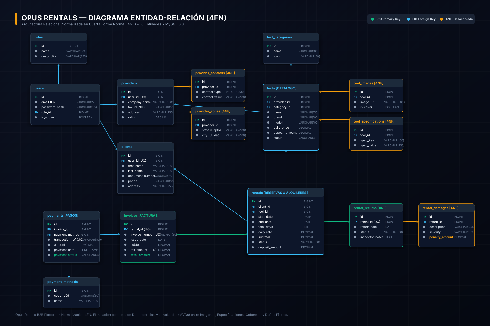

# OPUS RENTALS — HEAVY MACHINERY & INDUSTRIAL EQUIPMENT RENTAL PLATFORM

<div align="center">


[](https://openjdk.org/)
[](https://spring.io/projects/spring-boot)
[](https://spring.io/projects/spring-security)
[](https://www.mysql.com/)
[](https://vitejs.dev/)
[](https://tailwindcss.com/)
[](https://www.docker.com/)
[](./LICENSE)

**Enterprise-grade B2B equipment rental and management platform engineered with Hexagonal Architecture (Ports and Adapters), Domain-Driven Design (DDD), 4th Normal Form (4NF) relational persistence, and a reactive, zero-framework frontend.**

[Architecture Documentation](./docs/ARQUITECTURA_4FN.md) • [Build & Compilation Guide](./docs/COMPILACION.md) • [Deployment Manual](./docs/DESPLIEGUE.md) • [API Specification (Swagger)](http://localhost:8080/swagger-ui.html)

</div>

---

## AUTHORS & CORE CONTRIBUTORS

| Contributor | Role & Responsibilities | GitHub | Email |
| :--- | :--- | :--- | :--- |
| **Diego Mantilla** | Lead Architect, Backend Engineer (Spring Boot & 4NF) & Frontend Developer | [@DMntill4](https://github.com/DMntill4) | dmantill44@gmail.com |

---

## 1. TECHNICAL STACK & DEPENDENCY INVENTORY

### Backend Ecosystem
- **Language**: Java 21 LTS
- **Core Framework**: Spring Boot 3.3.4
- **Security & Authorization**: Spring Security 6.x with Stateless JWT (`io.jsonwebtoken:jjwt:0.12.6`)
- **Persistence & ORM**: Spring Data JPA / Hibernate 6 (`org.hibernate.orm:hibernate-core`)
- **Relational Database**: MySQL 8.0+ with InnoDB engine and explicit UTF-8 mb4 encoding
- **Bean Validation**: Jakarta Bean Validation API with Hibernate Validator (`org.springframework.boot:spring-boot-starter-validation`)
- **API Documentation**: SpringDoc OpenAPI 3.0 / Swagger UI (`org.springdoc:springdoc-openapi-starter-webmvc-ui:2.6.0`)
- **Code Generation & Boilerplate Reduction**: Project Lombok 1.18.36
- **Build & Packaging**: Apache Maven 3.8+ (Autonomous Executable JAR & Apache Tomcat 10.1+ Native WAR dual target)

### Frontend Ecosystem
- **Bundler & Development Engine**: Vite 8.3.0 (ESM native HMR)
- **Runtime & Language**: Vanilla JavaScript (ECMAScript 2024 Modules), zero runtime framework dependencies for maximum performance and sub-100ms load times
- **Styling Architecture**: Tailwind CSS 3.4.17 + PostCSS 8.5.30 + Autoprefixer 10.6.1
- **Design Tokens**: Slate 950 industrial palette, Construction Amber (`#f59e0b`), Deep Corporate Navy (`#132e4f`), and High-Contrast Typography (Outfit + Inter)
- **Iconography**: Lucide 1.56.0 (dynamic SVG rendering engine)
- **UI Components & Interactions**: Preline UI 2.7.0
- **HTTP Client**: Native Fetch API wrapper (`api/client.js`) featuring automated JWT Bearer authorization headers, error boundaries, and response unwrapping

### Infrastructure & Operations
- **Containerization**: Docker Engine 24.0+ & Docker Compose v2+
- **Reverse Proxy / Production Gateway**: Nginx 1.27 Alpine
- **Database Migrations**: Deterministic SQL initialization scripts (`database/init/01_schema.sql`, `database/init/02_data.sql`)

---

## 2. ARCHITECTURAL PATTERN: HEXAGONAL + DOMAIN-DRIVEN DESIGN (DDD)

The backend is partitioned into independent **Bounded Contexts** following Domain-Driven Design and Hexagonal Architecture principles. Business domain logic remains isolated from delivery channels (HTTP REST) and infrastructure concerns (JPA / MySQL):

```text
com.opusrentals/
├── config/                          # Cross-cutting configurations (CORS filters, OpenAPI Swagger)
├── security/                        # Spring Security 6 + Stateless JWT Filters
│   ├── jwt/                         # JwtTokenProvider, JwtAuthenticationFilter, JwtAuthenticationEntryPoint
│   └── service/                     # CustomUserDetailsService
├── shared/                          # Universal DTOs & exception handling
│   ├── dto/ApiResponse.java        # Standardized uniform response envelope: { success, message, data }
│   └── exception/                   # GlobalExceptionHandler, ResourceNotFoundException, ConflictException, BadRequestException
└── modules/
    ├── user/                        # Bounded Context: Security, Users, Roles, Clients & Providers
    ├── tool/                        # Bounded Context: Heavy Machinery, Categories, Specifications & Images
    ├── rental/                      # Bounded Context: Bookings, Date Collision Engine, Inspections & Damages
    ├── billing/                     # Bounded Context: Invoices, Tax Settlement (19% VAT), Payments & Gateway
    └── report/                      # Bounded Context: Business KPIs, Fleet Utilization & Revenue Analytics
```

### Layer Separation Within Each Bounded Context:
- **`controller/`**: Inbound HTTP primary adapters exposing REST endpoints annotated with OpenAPI tags.
- **`service/`**: Application services orchestrating use cases (preventing booking collisions, computing fiscal amounts, processing returns).
- **`repository/`**: Outbound secondary adapters extending Spring Data JPA with custom JPQL queries.
- **`entity/`**: Relational domain models strictly aligned with 4th Normal Form (4NF).
- **`dto/`**: Request and response immutable data transfer objects with Jakarta Validation constraints.

---

## 3. RELATIONAL SCHEMA & FOURTH NORMAL FORM (4NF)

<div align="center">



*Figura 1: Diagrama Entidad-Relación de Opus Rentals en Cuarta Forma Normal (4NF) — 16 Tablas Normalizadas.*

</div>

### Theoretical Justification of 4NF
A relation $R$ is in **Fourth Normal Form (4NF)** if and only if, for every non-trivial Multivalued Dependency (MVD) $X \twoheadrightarrow Y$, $X$ is a superkey of $R$.

1. **Equipment Specifications & Gallery Decoupling**:
   - An industrial machine possesses multiple gallery photos and multiple technical specifications (operating weight, horsepower, bucket capacity).
   - Combining these into a single entity creates Cartesian product redundancy ($tool\_id \twoheadrightarrow image\_url \mid spec$).
   - **4NF Resolution**: Independent normalized tables `tool_images(id, tool_id, image_url, is_cover)` and `tool_specifications(id, tool_id, spec_key, spec_value)`.
2. **Provider Contacts & Territorial Coverage Decoupling**:
   - A machinery provider operates multiple contact lines (telephones, corporate emails) and multiple geographical operational zones (departments, cities). There is no functional relation between phone numbers and cities.
   - **4NF Resolution**: Independent tables `provider_contacts(id, provider_id, contact_type, contact_value)` and `provider_coverage_zones(id, provider_id, state, city)`.
3. **Equipment Returns & Damage Penalization Decoupling**:
   - Return inspections evaluate general equipment condition and separately track independent damage incidences with individualized monetary penalties.
   - **4NF Resolution**: `rental_returns(id, rental_id, return_date, ...)` and `rental_damages(id, return_id, description, severity, penalty_amount)`.

### Complete 16-Table Relational Schema:
1. `roles`: Security roles (`ROLE_ADMIN`, `ROLE_PROVIDER`, `ROLE_CLIENT`).
2. `users`: Credentials, emails, encrypted password hashes (BCrypt).
3. `clients`: Client business profiles, company tax IDs, contact information.
4. `providers`: Equipment supplier corporate profiles, verification status.
5. `provider_contacts`: Multi-channel communication records (4NF).
6. `provider_coverage_zones`: Regional operational territories (4NF).
7. `tool_categories`: Hierarchical fleet categorization.
8. `tools`: Heavy equipment catalog, daily rental rates, replacement values.
9. `tool_images`: Multi-angle photography gallery (4NF).
10. `tool_specifications`: Engineering specifications and technical datasheets (4NF).
11. `rentals`: Contractual bookings, date ranges, status machine (`PENDING`, `APPROVED`, `IN_PROGRESS`, `RETURNED`, `CANCELLED`).
12. `rental_returns`: Reception physical audit records.
13. `rental_damages`: Damage penalty settlements (4NF).
14. `invoices`: Official fiscal invoices with automated legal tax breakdown (19% VAT).
15. `payment_methods`: Approved payment instruments (Credit Cards, PSE, Bank Wire).
16. `payments`: Payment gateway audit trails and settlement records.

---

## 4. CORE BUSINESS WORKFLOWS

### Date Collision Engine (Zero-Overbooking Guarantee)
Before any reservation is saved to the database, the backend executes an atomic overlapping query:
```sql
SELECT COUNT(r) > 0 FROM Rental r 
WHERE r.tool.id = :toolId 
  AND r.status NOT IN ('CANCELLED', 'RETURNED') 
  AND r.startDate <= :endDate 
  AND r.endDate >= :startDate
```
If a conflicting booking exists within the requested date span, the transaction immediately rolls back with an HTTP `409 Conflict` and descriptive localized feedback.

### Fiscal Invoice & Pricing Precision
- **Daily Rate Calculation**: `subtotal = dailyPrice * totalDays`.
- **National VAT (19%)**: `taxAmount = subtotal * 0.19` (Half-Up rounding, 2 decimal places).
- **Transaction Total**: `totalAmount = subtotal + taxAmount`.
- **Deposit Policy**: Security deposits (`depositAmount`) are tracked exclusively for asset protection and physical handover agreements; they are not conflated with transaction invoice totals.

---

## 5. QUICK START & RUNNING LOCALLY

### Prerequisites
- Java 21 JDK
- Node.js 20+ & npm 10+
- MySQL 8.0+ or Docker Desktop

### 1. Database Initialization
Create and populate the database using the provided deterministic SQL scripts:
```bash
mysql -u root -p < database/init/01_schema.sql
mysql -u root -p < database/init/02_data.sql
```

### 2. Configuration (`application.properties`)
The backend is preconfigured to load production properties and fallback defaults from `backend/src/main/resources/application.properties`:
```properties
# Spring Application & Server
spring.application.name=opus-rentals-backend
server.port=8080

# MySQL DataSource
spring.datasource.url=jdbc:mysql://localhost:3306/opus_rentals_db?useSSL=false&allowPublicKeyRetrieval=true&serverTimezone=UTC
spring.datasource.username=opus_user
spring.datasource.password=opus_secure_password_2026
spring.datasource.driver-class-name=com.mysql.cj.jdbc.Driver

# JPA & Hibernate
spring.jpa.hibernate.ddl-auto=none
spring.jpa.properties.hibernate.dialect=org.hibernate.dialect.MySQLDialect

# JWT Security
app.jwt.secret=404E635266556A586E3272357538782F413F4428472B4B6250645367566B5970
app.jwt.expiration-ms=86400000

# CORS Allowed Origins
app.cors.allowed-origins=http://localhost:5173,http://localhost:3000,http://localhost:80
```

### 3. Launch Backend (Spring Boot 3)
```bash
cd backend
./mvnw clean spring-boot:run
```
Backend API will start at: `http://localhost:8080`
Interactive Swagger UI: `http://localhost:8080/swagger-ui.html`

### 4. Launch Frontend (Vite)
```bash
cd frontend
npm install
npm run dev
```
Frontend Web Application: `http://localhost:5173`

### 5. Autonomous Docker Deployment
To launch the entire platform (MySQL + Spring Boot + Frontend Nginx) in a single command:
```bash
docker compose up -d --build
```

---

## 6. API ENDPOINTS & JSON SPECIFICATION

### Authentication (`/api/v1/auth`)
- `POST /api/v1/auth/login`: Authenticate and obtain JWT token.
```json
// Request
{
  "usernameOrEmail": "cli_constructora_col",
  "password": "Password123*"
}
// Response
{
  "success": true,
  "message": "Autenticación exitosa",
  "data": {
    "token": "eyJhbGciOiJIUzI1NiJ9...",
    "type": "Bearer",
    "id": 1,
    "username": "cli_constructora_col",
    "email": "contacto@constructora.co",
    "roles": ["ROLE_CLIENT"]
  }
}
```

### Clients Management (`/api/v1/clients`)
- `GET /api/v1/clients`: List all registered clients (Admin only).
- `GET /api/v1/clients/{id}`: Detailed client profile by ID.
- `PUT /api/v1/clients/{id}`: Update client profile (Client Owner or Admin).
- `DELETE /api/v1/clients/{id}`: Delete or soft-deactivate client depending on rental history.

### Providers Management (`/api/v1/providers`)
- `GET /api/v1/providers`: List all machinery providers with contacts and coverage zones (Public).
- `GET /api/v1/providers/{id}`: Detailed provider corporate sheet by ID (Public).
- `PUT /api/v1/providers/{id}`: Update corporate data, contact channels, and service coverage zones (Provider Owner or Admin).
- `DELETE /api/v1/providers/{id}`: Delete or soft-deactivate provider depending on fleet catalog history.

### Equipment Catalog (`/api/v1/tools`)
- `GET /api/v1/tools`: List all tools with optional category, status, and keyword filters.
- `GET /api/v1/tools/{id}`: Detailed specification sheet, images, and provider info.
- `POST /api/v1/tools`: Register new machine (Provider/Admin).

### Rental Reservations (`/api/v1/rentals`)
- `POST /api/v1/rentals`: Request booking with date validation and conflict checks.
```json
// Request (Headers: Authorization: Bearer <token>)
{
  "toolId": 1,
  "startDate": "2026-10-18",
  "endDate": "2026-10-20",
  "notes": "Entrega en frente de obra norte"
}
// Response
{
  "success": true,
  "message": "Reserva creada exitosamente",
  "data": {
    "id": 5,
    "toolId": 1,
    "toolName": "Excavadora Hidráulica CAT 320 GC",
    "totalDays": 3,
    "dailyRate": 850000.00,
    "subtotal": 2550000.00,
    "totalAmount": 3034500.00,
    "depositAmount": 2500000.00,
    "status": "PENDING",
    "invoiceId": 12,
    "invoiceNumber": "INV-2026-AB71C3D9"
  }
}
```
- `GET /api/v1/rentals/my-rentals`: Current user's rental history.
- `GET /api/v1/rentals/provider-requests`: Incoming rental requests for provider inventory.
- `GET /api/v1/rentals/tool/{toolId}/booked-dates`: Public query for currently booked or pending date ranges (used by interactive calendars to highlight unavailable periods in red).
- `PATCH /api/v1/rentals/{id}/status`: Transition booking state (`APPROVED`, `IN_PROGRESS`, `CANCELLED`).
- `POST /api/v1/rentals/{id}/cancel` & `PATCH /api/v1/rentals/{id}/cancel`: User cancellation endpoint.

### Invoices & Payments (`/api/v1/invoices`, `/api/v1/payments`)
- `GET /api/v1/invoices/my-invoices`: Retrieve user invoices.
- `GET /api/v1/invoices/rental/{rentalId}`: Retrieve official fiscal invoice breakdown.
- `GET /api/v1/payments`: List all payments across platform (Admin only).
- `GET /api/v1/payments/{id}`: Detailed payment record by ID.
- `POST /api/v1/payments`: Register payment against an issued invoice.
- `PATCH /api/v1/payments/{id}/refund`: Refund payment transaction and revert invoice to ISSUED (Admin only).
- `DELETE /api/v1/payments/{id}`: Void payment record and revert invoice (Admin only).

### Returns & Physical Inspection (`/api/v1/returns`)
- `POST /api/v1/returns/rental/{rentalId}`: Process equipment check-in with optional damage items (4NF).

### Admin Reports & Analytics (`/api/v1/admin/reports`)
- `GET /api/v1/admin/reports/dashboard`: Executive metrics, revenue trend by month, and top rented equipment.
- `GET /api/v1/admin/reports/top-tools`: Ranking of most rented machinery and generated revenues.
- `GET /api/v1/admin/reports/frequent-clients`: Ranking of frequent clients, active reservations, and total spend.
- `GET /api/v1/admin/reports/fleet-status`: Fleet availability breakdown (available, rented, maintenance, retired) and utilization metrics per category.

---

## 7. POSTMAN TEST COLLECTION

The project includes an official Postman collection preconfigured with automated JWT token handling, environment variables, and realistic request payloads for all business modules:

- **Collection File**: [`docs/OpusRentals.postman_collection.json`](./docs/OpusRentals.postman_collection.json)
- **Import Instructions**:
  1. Open Postman.
  2. Click **Import** (top left).
  3. Drag and drop or select `docs/OpusRentals.postman_collection.json`.
  4. The collection variable `{{baseUrl}}` is preset to `http://localhost:8080/api/v1`.
- **Preconfigured Request Folders**:
  1. `1. Authentication`: Login as Admin, Provider, Client, and Register Client & Provider.
  2. `2. Clients Management`: Get All Clients, Get by ID, Update Profile, Delete/Deactivate Client.
  3. `3. Providers Management`: Get All Providers, Get by ID, Update Provider, Delete/Deactivate Provider.
  4. `4. Tools & Catalog`: Public catalog query, search by keyword, filter by ID, categories, and Provider tool creation (POST).
  5. `5. Rentals & Returns`: Client rental creation with dates, rental history, provider requests, status transitions (PATCH), and return inspections with 4NF damage items.
  6. `6. Billing & Payments`: Payment methods query, user invoices, global payment audits, checkout processing, and payment refunds.
  7. `7. Admin Reports & Analytics`: Platform KPI dashboard, most rented tools, frequent clients ranking, fleet status/availability, and user directory administration.

---

## 8. AUTOMATED TESTING GUIDE

The project includes comprehensive unit and integration tests executing under the `test` profile:

### Execute Backend Tests
```bash
cd backend
./mvnw test
```
*(Or via Docker: `docker run --rm -v "${PWD}:/app" -w /app maven:3.9.6-eclipse-temurin-21-alpine mvn test`)*

### Test Coverage Highlights
- `RentalServiceUnitTest`: Validates the date collision engine, subtotal and VAT calculations, and prevents overbooking conflicts.
- `UserServiceUnitTest`: Validates full CRUD operations for Clients and Providers, owner vs admin authorization, and 4NF transactional integrity with soft-deactivation when historical dependencies exist.
- `PaymentServiceUnitTest`: Validates checkout processing, status transitions, idempotent payment rejection, and refund mechanisms with automatic invoice status rollback.
- `ReportServiceUnitTest`: Validates dashboard metric calculations, frequent client aggregations, and fleet utilization breakdowns.
- `OpusRentalsApplicationTests`: Verifies Spring context loading and security filter chain initialization.

---

## 9. PRECONFIGURED SYSTEM ROLES & DEMONSTRATION CREDENTIALS

The database seed provides operational accounts for all three user archetypes:

| Role | Username | Password | Key Responsibilities |
| :--- | :--- | :--- | :--- |
| **Administrator** | `admin_principal` | `Password123*` | System KPIs, supplier verification, global rental audits, user role administration |
| **Machinery Provider** | `prov_maquinaria_bog` | `Password123*` | Fleet inventory CRUD, rental request approval/rejection, technical check-in inspections & damages |
| **Client / Contractor** | `cli_constructora_col` | `Password123*` | Catalog search & filters, live availability check, checkout payment, official invoice PDF/HTML viewer |

---

## 10. PROJECT REPOSITORY STRUCTURE

```text
opus-rentals/
├── docker-compose.yml               # Multi-container orchestration specification
├── database/
│   └── init/
│       ├── 01_schema.sql            # DDL: 16 tables, 4NF foreign keys and check constraints
│       └── 02_data.sql              # DML: Production catalogs and baseline roles
├── backend/
│   ├── pom.xml                      # Maven project configuration (Java 21, Spring Boot 3.3.4)
│   └── src/main/java/com/opusrentals/
│       ├── config/                  # CORS, Swagger OpenAPI configuration
│       ├── security/                # JWT filters, TokenProvider, UserDetailsService
│       ├── shared/                  # Common responses, GlobalExceptionHandler
│       └── modules/                 # Bounded contexts (user, tool, rental, billing, report)
├── frontend/
│   ├── package.json                 # Node dependencies (Vite 8, Tailwind 3.4, Lucide)
│   ├── index.html                   # HTML5 Entrypoint
│   └── src/
│       ├── api/                     # Unified HTTP client and mock store fallbacks
│       ├── auth/                    # JWT session and role state management
│       ├── components/              # Modals, toasts, navigation, system skeletons
│       ├── utils/                   # Currency formatters, Lucide icon renderer, i18n
│       └── views/                   # Dynamic views: Catalog, Product Detail, Dashboards, Invoices
└── docs/
    ├── ARQUITECTURA_4FN.md          # Mathematical 4NF proof and ERD diagram
    ├── COMPILACION.md               # Build instructions for local JAR and Tomcat WAR
    └── DESPLIEGUE.md                # Deployment manual for Docker and production environments
```
