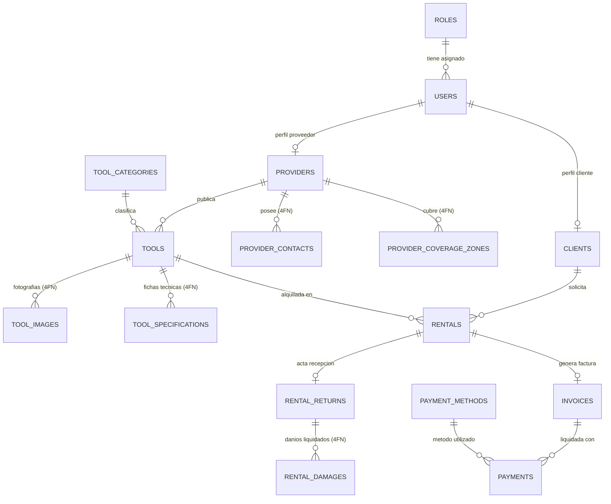

# PLATAFORMA DE RENTA DE HERRAMIENTAS Y EQUIPOS DE CONSTRUCCIÓN
## OPUS RENTALS

Sistema integral para la gestión, reserva, alquiler y facturación de herramientas y maquinaria de construcción, desarrollado con **Arquitectura Hexagonal (Puertos y Adaptadores)**, principios de **Domain-Driven Design (DDD)** organizado por módulos de negocio, persistencia relacional con **Normalización en Cuarta Forma Normal (4FN)** en **MySQL 8.0**, seguridad basada en **Spring Security 6 con JWT (RBAC)** y un frontend moderno con **React + Vite + Tailwind CSS**.

---

## 1. TECNOLOGÍAS UTILIZADAS

### Backend
- **Lenguaje**: Java 21 (LTS)
- **Framework**: Spring Boot 3.3.4
- **Seguridad**: Spring Security 6.x con JSON Web Tokens (JJWT 0.12.6)
- **Persistencia**: Spring Data JPA / Hibernate 6
- **Base de Datos**: MySQL 8.0+
- **Validación**: Jakarta Bean Validation (`hibernate-validator`)
- **Documentación de API**: Springdoc OpenAPI 3.0 / Swagger UI (`springdoc-openapi-starter-webmvc-ui 2.6.0`)
- **Empaquetado**: Maven (Soporte dual WAR para Tomcat nativo y JAR autónomo)

### Frontend
- **Framework**: React 18 / 19
- **Bundler & Dev Server**: Vite 5
- **Estilos**: Tailwind CSS 3.4
- **Iconografía**: Lucide React
- **Cliente HTTP**: Axios con interceptor dinámico de tokens JWT
- **Servidor Web**: Nginx 1.27 Alpine (Modo contenedor con reverse proxy)

### Infraestructura & Despliegue
- **Contenedores**: Docker Engine & Docker Compose
- **Servidor de Aplicaciones**: Apache Tomcat 10.1+ (Despliegue nativo WAR)

---

## 2. ARQUITECTURA DEL SISTEMA: HEXAGONAL + DDD POR MÓDULOS

El backend sigue una arquitectura modular donde cada módulo representa un **Bounded Context** de negocio. El código está escrito en **inglés técnico**, manteniendo la lógica de negocio desacoplada de la tecnología de persistencia o entrega:

```text
com.opusrentals/
├── config/                          # Configuración global (CORS, OpenAPI/Swagger)
├── security/                        # Spring Security 6 + Filtros JWT Stateless
│   ├── jwt/                         # JwtTokenProvider, JwtAuthenticationFilter, JwtEntryPoint
│   └── service/                     # CustomUserDetailsService
├── shared/                          # Clases transversales
│   ├── dto/ApiResponse.java        # Envoltorio uniforme para respuestas REST
│   └── exception/                   # GlobalExceptionHandler, ResourceNotFoundException, ConflictException
└── modules/
    ├── user/                        # Bounded Context: Autenticación, Usuarios, Clientes y Proveedores
    ├── tool/                        # Bounded Context: Inventario, Categorías, Especificaciones y Fotos
    ├── rental/                      # Bounded Context: Reservas, Disponibilidad, Devoluciones y Daños
    ├── billing/                     # Bounded Context: Facturación Automática, Métodos de Pago y Transacciones
    └── report/                      # Bounded Context: KPIs, Métricas de Ocupación y Rentabilidad
```

### Separación de Capas por Módulo:
- **`controller/`**: Adaptadores primarios que exponen endpoints REST documentados con OpenAPI.
- **`service/`**: Lógica de aplicación y orquestación de casos de uso (disponibilidad anti-colisiones, cálculo de impuestos, generación de comprobantes).
- **`repository/`**: Adaptadores secundarios de persistencia con Spring Data JPA.
- **`entity/`**: Modelos de datos mapeados a tablas MySQL cumpliendo 4FN.
- **`dto/`**: Objetos inmutables de transferencia de datos con validaciones estrictas (`@NotBlank`, `@DecimalMin`, `@FutureOrPresent`).

---

## 3. MODELO DE DATOS Y NORMALIZACIÓN EN CUARTA FORMA NORMAL (4FN)

### 3.1. Justificación Teórica de 4FN
Para alcanzar la **4FN**, la base de datos debe cumplir con **BCNF (Boyce-Codd)** y eliminar cualquier **Dependencia Multivaluada (MVD)** independiente no trivial ($X \twoheadrightarrow Y \mid Z$):

1. **Herramientas (Desacoplamiento de Fotos y Especificaciones)**:
   - Una herramienta tiene múltiples imágenes fotográficas y múltiples especificaciones técnicas (potencia, peso, combustible).
   - Si se mantuviesen en una sola tabla, se crearía una redundancia cartesiana ($tool\_id \twoheadrightarrow image\_url \mid spec$).
   - **Solución 4FN**: Tablas atómicas separadas `tool_images(id, tool_id, image_url, is_cover)` y `tool_specifications(id, tool_id, spec_key, spec_value)`.
2. **Proveedores (Desacoplamiento de Contactos y Coberturas)**:
   - Un proveedor cuenta con múltiples líneas de contacto (teléfonos, emails) y múltiples zonas de cobertura geográfica (ciudades). No existe dependencia entre un número telefónico y una ciudad.
   - **Solución 4FN**: Tablas independientes `provider_contacts(id, provider_id, contact_type, contact_value)` y `provider_coverage_zones(id, provider_id, state, city)`.
3. **Devoluciones (Desacoplamiento de Daños e Inspección)**:
   - La devolución registra el estado formal del equipo y, de manera desacoplada, los daños físicos encontrados con su respectivo costo de penalización.
   - **Solución 4FN**: `rental_returns` y `rental_damages(id, return_id, description, severity, penalty_amount)`.

### 3.2. Diagrama Entidad-Relación (ERD)



---

## 4. INICIO RÁPIDO Y EJECUCIÓN CON DOCKER (RECOMENDADO)

### Paso 1: Clonar e ingresar al repositorio
```bash
git clone https://github.com/DMntill4/opus-rentals.git
cd opus-rentals
```

> **Estrategia de Ramas**: El desarrollo activo se centraliza en la rama `develop`, mientras que las versiones consolidadas se integran a la rama `main`.

### Paso 2: Configurar el entorno
Copie el archivo de variables de entorno:
```bash
cp .env.example .env
```

### Paso 3: Levantar el ecosistema
```bash
docker compose up -d --build
```

El script poblará automáticamente MySQL con **más de 20 registros consistentes por entidad** tomados de `database/init/01_schema.sql` y `database/init/02_data.sql`.

### URLs de Acceso:
- **Aplicación Web (Frontend)**: [http://localhost](http://localhost) (Puerto 80)
- **Documentación Swagger / OpenAPI**: [http://localhost:8080/swagger-ui.html](http://localhost:8080/swagger-ui.html)
- **Documentación OpenAPI JSON**: [http://localhost:8080/v3/api-docs](http://localhost:8080/v3/api-docs)

---

## 5. CREDENCIALES POR DEFECTO PARA PRUEBAS

Todos los usuarios cuentan con la contraseña unificada: `password123`

| Rol | Correo Electrónico | Contraseña | Vistas y Funcionalidades |
| :--- | :--- | :--- | :--- |
| **ADMIN** | `admin@opusrentals.com` | `password123` | Dashboard general con métricas de rentabilidad, herramientas más rentadas, gestión y bloqueo de usuarios, auditoría global. |
| **PROVEEDOR** | `provider.caterpillar@opusrentals.com` | `password123` | Gestión de inventario de equipos, subida de fotos y especificaciones, aprobación de solicitudes y acta de recepción con daños (4FN). |
| **CLIENTE** | `client.carlos@gmail.com` | `password123` | Catálogo con filtros, solicitud de reserva con validación temporal, pasarela de pago simulada y descarga de facturas legales. |

---

## 6. CATÁLOGO DE ENDPOINTS DE LA API (REST + JSON)

### 6.1. Autenticación (`/api/v1/auth`)
| Método | Endpoint | Permiso | Descripción |
| :--- | :--- | :--- | :--- |
| `POST` | `/api/v1/auth/login` | Público | Autenticación y obtención del token JWT Bearer. |
| `POST` | `/api/v1/auth/register/client` | Público | Registro de cliente con documento, teléfono y dirección. |
| `POST` | `/api/v1/auth/register/provider` | Público | Registro de proveedor con razón social, NIT, contactos y zonas. |

#### Ejemplo de Request: `POST /api/v1/auth/login`
```json
{
  "email": "admin@opusrentals.com",
  "password": "password123"
}
```
#### Ejemplo de Response:
```json
{
  "success": true,
  "message": "Inicio de sesión exitoso",
  "data": {
    "token": "eyJhbGciOiJIUzI1NiIsIn...",
    "tokenType": "Bearer",
    "userId": 1,
    "email": "admin@opusrentals.com",
    "role": "ROLE_ADMIN",
    "displayName": "Administrador del Sistema"
  }
}
```

---

### 6.2. Inventario y Herramientas (`/api/v1/tools`)
| Método | Endpoint | Permiso | Descripción |
| :--- | :--- | :--- | :--- |
| `GET` | `/api/v1/tools` | Público | Consulta de herramientas con filtros por categoría, estado y búsqueda. |
| `GET` | `/api/v1/tools/{id}` | Público | Consulta detallada con imágenes y especificaciones técnicas (4FN). |
| `POST` | `/api/v1/tools` | `PROVEEDOR`, `ADMIN` | Creación de equipo con tarifas, depósito, imágenes y especificaciones. |
| `PUT` | `/api/v1/tools/{id}` | `PROVEEDOR`, `ADMIN` | Actualización de datos de la herramienta propia. |
| `DELETE`| `/api/v1/tools/{id}` | `PROVEEDOR`, `ADMIN` | Eliminación de herramienta. |

#### Ejemplo de Request: `POST /api/v1/tools`
```json
{
  "categoryId": 1,
  "name": "Excavadora Compacta Cat 305",
  "brand": "Caterpillar",
  "model": "305 CR",
  "dailyPrice": 320000.00,
  "depositAmount": 1200000.00,
  "images": [
    {
      "imageUrl": "https://images.unsplash.com/photo-1579762715118-a6f1d4b934f1",
      "isCover": true
    }
  ],
  "specifications": [
    { "specKey": "Potencia Neta", "specValue": "48.9 HP" },
    { "specKey": "Profundidad de Excavación", "specValue": "3.82 m" }
  ]
}
```

---

### 6.3. Reservas y Alquileres (`/api/v1/rentals`)
| Método | Endpoint | Permiso | Descripción |
| :--- | :--- | :--- | :--- |
| `POST` | `/api/v1/rentals` | `CLIENTE`, `ADMIN` | Reserva de equipo validando no-solapamiento de fechas. Genera factura. |
| `GET` | `/api/v1/rentals/my-rentals` | `CLIENTE`, `ADMIN` | Historial de alquileres del cliente autenticado. |
| `GET` | `/api/v1/rentals/provider-requests` | `PROVEEDOR`, `ADMIN` | Bandeja de solicitudes de alquiler para el proveedor. |
| `PATCH`| `/api/v1/rentals/{id}/status` | Autenticado | Aprobación (`APPROVED`), rechazo o cancelación (`CANCELLED`). |

#### Ejemplo de Request: `POST /api/v1/rentals`
```json
{
  "toolId": 1,
  "startDate": "2026-11-01",
  "endDate": "2026-11-05",
  "notes": "Entrega en obra proyecto Calle 93 con Cra 11"
}
```

---

### 6.4. Devoluciones e Inspección de Daños (`/api/v1/returns`)
| Método | Endpoint | Permiso | Descripción |
| :--- | :--- | :--- | :--- |
| `POST` | `/api/v1/returns/rental/{rentalId}` | `PROVEEDOR`, `ADMIN` | Cierre del alquiler con acta de inspección y registro atómico de daños. |
| `GET` | `/api/v1/returns/rental/{rentalId}` | Autenticado | Consulta del informe de devolución y desglose de penalizaciones. |

#### Ejemplo de Request: `POST /api/v1/returns/rental/1`
```json
{
  "returnDate": "2026-11-05",
  "generalNotes": "Equipo devuelto en bodega",
  "inspectorNotes": "Revisión técnica detecta rotura de manguera de alta presión",
  "damages": [
    {
      "description": "Manguera de circuito hidráulico reventada",
      "severity": "MODERATE",
      "penaltyAmount": 150000.00
    }
  ]
}
```

---

### 6.5. Facturación y Pagos (`/api/v1/invoices` y `/api/v1/payments`)
| Método | Endpoint | Permiso | Descripción |
| :--- | :--- | :--- | :--- |
| `GET` | `/api/v1/payment-methods` | Público | Lista los métodos de pago habilitados (Tarjetas, PSE, etc.). |
| `GET` | `/api/v1/invoices/my-invoices` | Autenticado | Consulta las facturas del usuario actual (Cliente o Proveedor). |
| `POST` | `/api/v1/payments` | Autenticado | Simula y registra la transacción de pago, pasando la factura a `PAID`. |

---

### 6.6. Métricas y Supervisión (`/api/v1/admin`)
| Método | Endpoint | Permiso | Descripción |
| :--- | :--- | :--- | :--- |
| `GET` | `/api/v1/admin/reports/dashboard`| `ADMIN` | Métricas generales, ingresos por mes y top 10 de herramientas más rentadas. |
| `GET` | `/api/v1/admin/users` | `ADMIN` | Listado completo de usuarios registrados en el sistema. |
| `PATCH`| `/api/v1/admin/users/{id}/status` | `ADMIN` | Inhabilita o reactiva cuentas de usuario en la plataforma. |

---

## 7. SUITE DE PRUEBAS AUTOMATIZADAS Y POSTMAN

1. **Pruebas en Spring Boot**:
   ```bash
   cd backend
   mvn test
   ```
2. **Colección Postman**:
   - En la carpeta de documentación encontrará la colección lista:
     [`docs/OpusRentals.postman_collection.json`](file:///c:/Users/dalej/OneDrive/Documents/opus-rentals/docs/OpusRentals.postman_collection.json).
   - Impórtelo en Postman.
   - Ejecute la petición **1. Authentication > Login - Admin** para que el token JWT se guarde automáticamente en la variable de colección `{{token}}`.

---

## 8. DOCUMENTACIÓN ADICIONAL DEL REPOSITORIO (CARPETA `docs/`)

- Consulte [`docs/COMPILACION.md`](file:///c:/Users/dalej/OneDrive/Documents/opus-rentals/docs/COMPILACION.md) para detalles de construcción paso a paso.
- Consulte [`docs/DESPLIEGUE.md`](file:///c:/Users/dalej/OneDrive/Documents/opus-rentals/docs/DESPLIEGUE.md) para la configuración en Apache Tomcat nativo y Docker Compose.
- Consulte [`docs/ARQUITECTURA_4FN.md`](file:///c:/Users/dalej/OneDrive/Documents/opus-rentals/docs/ARQUITECTURA_4FN.md) para la demostración formal y matemática de la Cuarta Forma Normal.

