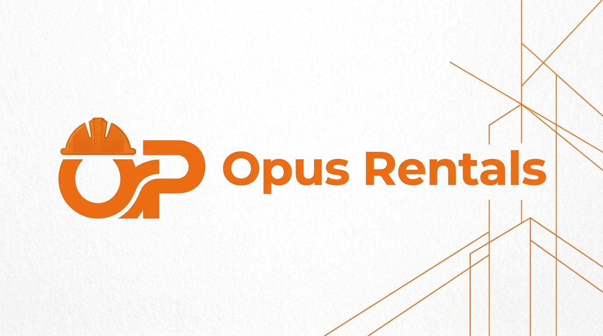
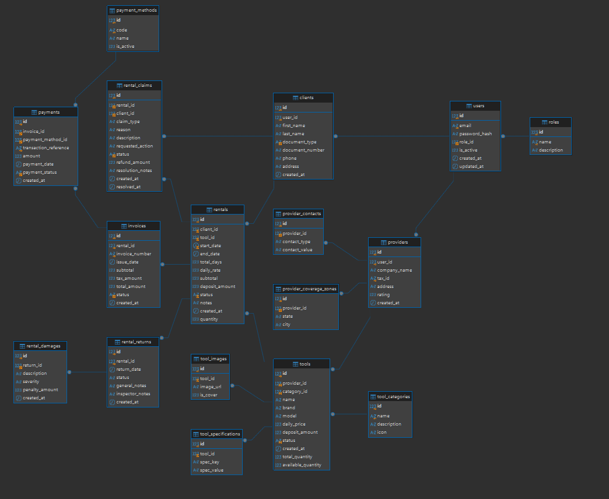

# OPUS RENTALS — HEAVY MACHINERY & INDUSTRIAL EQUIPMENT RENTAL PLATFORM

<div align="center">



[](https://openjdk.org/)
[](https://spring.io/projects/spring-boot)
[](https://spring.io/projects/spring-security)
[](https://www.mysql.com/)
[](https://vitejs.dev/)
[](https://tailwindcss.com/)
[](https://www.docker.com/)

**Plataforma B2B de alquiler y gestión de maquinaria pesada diseñada con Arquitectura Hexagonal (Puertos y Adaptadores), Domain-Driven Design (DDD), base de datos en Cuarta Forma Normal (4NF) y frontend reactivo.**

[Arquitectura 4FN](./docs/ARQUITECTURA_4FN.md) • [Compilación](./docs/COMPILACION.md) • [Despliegue](./docs/DESPLIEGUE.md) • [Postman Collection](./docs/OpusRentals.postman_collection.json) • [Swagger UI](http://localhost:8080/swagger-ui.html)

</div>

## 1. INICIO RÁPIDO

### Comando Universal de Ejecución (Monorepo)
Para levantar toda la plataforma (Base de Datos MySQL, Backend Spring Boot y Frontend Web), simplemente clona y ejecuta en la raíz del proyecto:

```bash
git clone https://github.com/DMntill4/opus-rentals.git
cd opus-rentals
npm run dev
```

**¿Qué realiza automáticamente `npm run dev`?**
1. **Detección inteligente de Docker**: Si el sistema cuenta con Docker activo, arranca los contenedores de MySQL 8.0 y Spring Boot 3 (`opus_mysql_db` y `opus_backend`).
2. **Respaldo automático sin Docker**: Si el computador no tiene Docker o carece de permisos de root, inicia el Frontend con el almacén de datos mock interactivo sin bloquearse ni arrojar errores.
3. **Instalación automática de dependencias**: En un clon limpio, detecta si falta `node_modules` e instala las dependencias necesarias de inmediato.
4. **Puntos de acceso**:
   - Frontend Web: `http://localhost:5173`
   - Backend API (si Docker está activo): `http://localhost:8080/api/v1`
   - Documentación Swagger: `http://localhost:8080/swagger-ui.html`

---

### Modos Alternativos de Despliegue

#### Despliegue 100% Contenedorizado con Docker Compose (Producción)
```bash
docker compose up -d --build
```
- Frontend Web: `http://localhost`
- Backend API: `http://localhost:8080/api/v1`

#### Ejecución Local Manual (Sin Docker: Java 21 + MySQL 8 + Node.js)

**1. Base de Datos MySQL:**
```bash
mysql -u root -p < database/init/01_schema.sql
mysql -u root -p < database/init/02_data.sql
```

**2. Backend (Spring Boot 3.3.4 & Java 21):**
```bash
cd backend
./mvnw clean spring-boot:run
```

**3. Frontend (Vite & Vanilla JS):**
```bash
cd frontend
npm install
npm run dev
```

---

## 2. ARQUITECTURA Y MODELO DE DATOS 4FN

El sistema está estructurado bajo principios de Domain-Driven Design (DDD) con separación estricta en Bounded Contexts y base de datos relacional en Cuarta Forma Normal (4NF) con 16 tablas sin dependencias multivaluadas:

```text
com.opusrentals/
├── config/                  # CORS, Swagger OpenAPI 3.0
├── security/                # Spring Security 6, JWT sin estado
├── shared/                  # DTO uniforme ApiResponse y GlobalExceptionHandler
└── modules/
    ├── user/                # Usuarios, Roles, Clientes y Proveedores
    ├── tool/                # Maquinaria, Categorías, Especificaciones y Galería
    ├── rental/              # Motor anticolisión de fechas, Alquileres, Recepción e Inspección
    ├── billing/             # Facturas fiscales (IVA 19%), Pasarela y Auditoría de Pagos
    └── report/              # Dashboard administrativo, KPIs y Analítica de Flota
```

### Modelo Relacional de Base de Datos


Para consultar la demostración matemática de 4NF y el diagrama relacional completo, consulta [docs/ARQUITECTURA_4FN.md](./docs/ARQUITECTURA_4FN.md).

---

## 3. RESUMEN DE ENDPOINTS API

| Módulo | Endpoint Principal | Descripción |
| :--- | :--- | :--- |
| **Auth** | `POST /api/v1/auth/login` | Autenticación con JWT Bearer y retorno de perfil |
| **Clientes** | `GET /api/v1/clients` | Gestión CRUD de clientes con soft delete en 4NF |
| **Proveedores** | `GET /api/v1/providers` | Directorio de proveedores, contactos y zonas |
| **Maquinaria** | `GET /api/v1/tools` | Catálogo de equipos con filtros de rubro y estado |
| **Alquileres** | `POST /api/v1/rentals` | Reserva con validación atómica anticolisión |
| **Facturación** | `GET /api/v1/invoices/my-invoices` | Facturas legales con liquidación de IVA 19% |
| **Pagos** | `POST /api/v1/payments` | Procesamiento PSE / Tarjeta y reembolso |
| **Reportes** | `GET /api/v1/admin/reports/dashboard` | Métricas operativas, utilización y clientes frecuentes |

La colección lista para importar en Postman con variables y token dinámico se encuentra en [docs/OpusRentals.postman_collection.json](./docs/OpusRentals.postman_collection.json).

---

## 4. CREDENCIALES DE DEMOSTRACIÓN

Todas las cuentas demo utilizan la contraseña: `password123`

| Rol | Correo de Acceso | Alcance y Funcionalidades |
| :--- | :--- | :--- |
| **Administrador** | `admin@opusrentals.com` | Métricas ejecutivas, auditoría de pagos, gestión global de usuarios |
| **Proveedor** | `provider.caterpillar@opusrentals.com` | Mi Flota (inventario en patio), aprobación de despachos y recepción |
| **Cliente** | `client.carlos@gmail.com` | Búsqueda en catálogo, cotizador en vivo, reservas y facturas |

*Nota: Existen 20 cuentas independientes de proveedores (Komatsu, Bosch, Hilti, Makita, etc.) disponibles en la base de datos.*

---

## 5. DOCUMENTACIÓN DETALLADA

- [Arquitectura de Base de Datos y Justificación 4NF](./docs/ARQUITECTURA_4FN.md)
- [Guía de Compilación de Artefactos (JAR y WAR)](./docs/COMPILACION.md)
- [Manual de Despliegue en Servidores y Docker](./docs/DESPLIEGUE.md)
- [Frontend README](./frontend/README.md)

---

## 6. AUTORES

- **Diego Mantilla** ([@DMntill4](https://github.com/DMntill4)) - Lead Architect & Full Stack Developer
